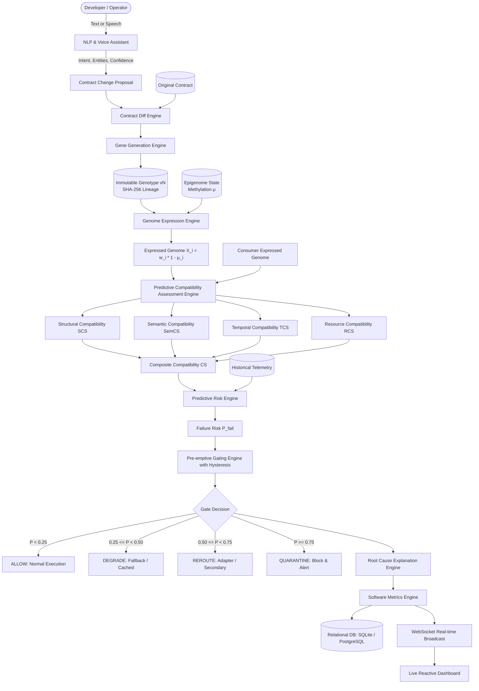

# System Architecture: Autonomous Contract Organisms (ACO) & Epigenetically Conditioned Contract Genomes (ECG)

## 1. Executive Summary

Distributed microservice architectures suffer from silent contract drift, runtime deserialization errors, and cascading failure cascades when producers mutate API schemas, performance envelopes, or invariant constraints. Traditional solutions (such as schema registries and post-mortem circuit breakers) only act *reactively* after live production requests have already failed.

The **Autonomous Contract Organism (ACO)** and **Epigenetically Conditioned Contract Genome (ECG)** paradigm introduces a biological-computing approach to microservice governance:
- **Contract as Genome**: Service contracts are compiled into discrete, typed, weighted *Genes*.
- **Immutable Genotype**: Cryptographic SHA-256 versioning ensures immutable lineage.
- **Reversible Epigenome**: Methylation coefficients ($\mu \in [0, 1]$) represent operational dampening, traffic shaping, and runtime adaptation without altering the committed genotype.
- **Predictive Compatibility Assessment Engine (PCAE)**: Evaluates Structural ($SCS$), Semantic ($SemCS$), Temporal ($TCS$), and Resource ($RCS$) compatibility before request dispatch.
- **Pre-emptive Gating**: Computes near-future failure probability $P_{fail}$ to gate interactions (`ALLOW`, `DEGRADE`, `REROUTE`, `QUARANTINE`) with hysteresis.

---

## 2. End-to-End Pipeline Architecture

---

## 3. Core Engine Specifications

### 3.1 Gene Families
Each contract specification is partitioned into atomic genes:
1. `SCHEMA_GENE`: Field name, primitive/composite type, required/optional status, array/enum definitions.
2. `INVARIANT_GENE`: Bounded mathematical constraints (e.g., $amount > 0$, $currency \in \{INR, USD, EUR\}$).
3. `TEMPORAL_GENE`: Latency deadlines, timeouts, deadline envelopes (e.g., $latency \le 2000ms$).
4. `RESOURCE_GENE`: Throughput capabilities, concurrency limits, payload size ceilings (e.g., $throughput \ge 500 RPS$).
5. `ERROR_TAXONOMY_GENE`: Error codes, retry policies, fallback semantics.

### 3.2 Epigenetic Expression Formula
For each gene $i$ at timestamp $t$:
$$X_i(t) = w_i \times (1 - \mu_i(t))$$
Where:
- $w_i \in [0, 1]$ is the nominal gene weight (criticality in contract).
- $\mu_i(t) \in [0, 1]$ is the methylation coefficient ($0$ = fully active, $1$ = completely silenced/suppressed).
- $X_i(t) \in [0, 1]$ is the effective expressed gene strength.

### 3.3 PCAE Compatibility Matrix
The overall compatibility score $CS \in [0, 1]$ is defined by:
$$CS = \alpha \cdot SCS + \beta \cdot SemCS + \gamma \cdot TCS + \delta \cdot RCS$$
Where $\alpha + \beta + \gamma + \delta = 1.0$ (default: $\alpha = 0.25, \beta = 0.25, \gamma = 0.25, \delta = 0.25$).

- **$SCS$ (Structural Compatibility Score)**:
  $$SCS = \frac{\sum_{g \in \text{Shared Schema Genes}} \text{match}(g_{req}, g_{prov}) \cdot \min(X_{req}, X_{prov})}{\sum_{g \in \text{Required Schema Genes}} w_g}$$
- **$SemCS$ (Semantic Compatibility Score)**:
  Evaluates bounded constraint satisfaction between consumer expectations and provider guarantees.
- **$TCS$ (Temporal Compatibility Score)**:
  $$TCS = \begin{cases} 1.0 & \text{if } T_{prov\_latency} \le T_{req\_timeout} \\ \max\left(0, 1.0 - \frac{T_{prov} - T_{req}}{T_{req}}\right) & \text{otherwise} \end{cases}$$
- **$RCS$ (Resource Compatibility Score)**:
  $$RCS = \begin{cases} 1.0 & \text{if } R_{prov\_throughput} \ge R_{req\_throughput} \\ \frac{R_{prov\_throughput}}{R_{req\_throughput}} & \text{otherwise} \end{cases}$$

### 3.4 Predictive Failure Estimation
$$P_{fail} = \sigma\left(k \cdot (\tau - CS) + m \cdot \text{trend}\right) = \frac{1}{1 + e^{-\left(k \cdot (\tau - CS) + m \cdot \text{trend}\right)}}$$
Where:
- $\tau$ is the critical compatibility threshold (default: $0.80$).
- $k$ is the sensitivity steepness (default: $8.0$).
- $m$ is the momentum sensitivity for historical degradation rate (default: $3.5$).
- $\text{trend} = \frac{\Delta CS}{\Delta t}$ over recent evaluation windows.

### 3.5 Pre-Emptive Gating with Hysteresis
To prevent flapping across threshold boundaries:
- Transition from lower severity to higher severity occurs immediately when threshold is breached.
- Transition from higher severity to lower severity requires score improvement by an additional hysteresis margin $\Delta_{hysteresis} = 0.05$.

---

## 4. Technology Stack & Component Separation

| Layer | Technologies | Responsibility |
|---|---|---|
| **Frontend** | React 19, TypeScript, Vite, Tailwind CSS, Lucide Icons, Recharts | Glassmorphism dashboard, 14 interactive views, live WebSocket feed, Web Speech API |
| **Backend** | Python 3.10+, FastAPI, Starlette WebSockets | REST API hub, WebSocket real-time event broadcasting, async pipeline execution |
| **Engines** | Pure Python + NumPy/Math | PCAE, Genotype Manager, Epigenome Manager, Prediction Engine, Gating Engine, NLP Parser, ECG-IR |
| **Database** | SQLAlchemy ORM + SQLite (local) / PostgreSQL (production) | Relational persistence of contracts, genotypes, epigenomes, metrics, events, proof certs |
| **Microservices** | FastAPI, Requests / HTTPX | Live consumer (`order-service`) and provider (`payment-service`) microservices |
| **DevOps** | Docker, Docker Compose | Containerized multi-service deployment |
